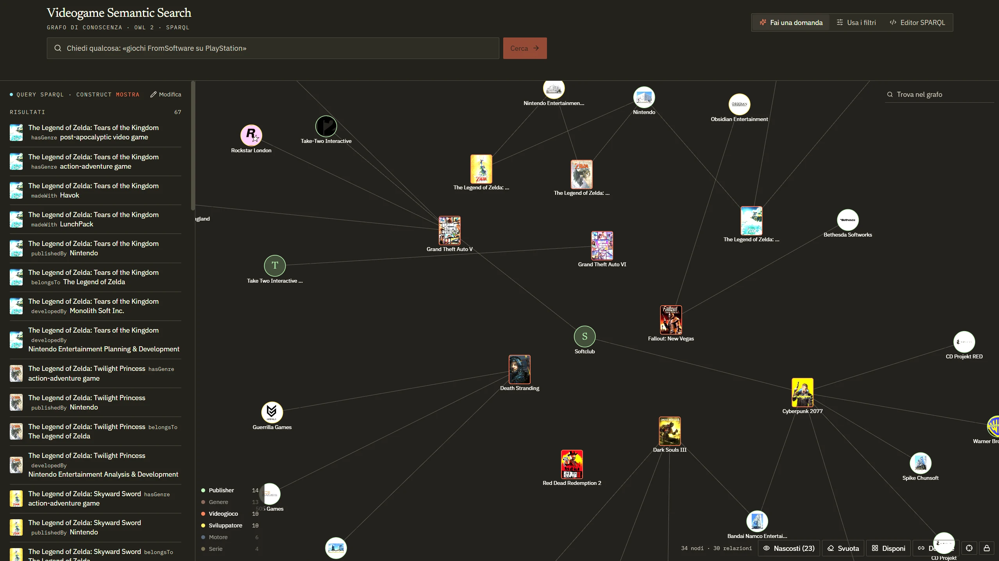

# Videogame Semantic Search



Un progetto di Semantic Web che costruisce e interroga un'ontologia OWL sui videogiochi (dal 2010 ad oggi) tramite un'interfaccia web moderna con grafo di conoscenza interattivo.

## Ontologia

L'ontologia (TBox in `ontology/videogames.owl`, che importa i moduli di `ontology/schema/`; regole CONSTRUCT in `ontology/rules/`; descritta nella relazione in `docs/relazione`) viene popolata con i dati di Wikidata dal 2010 ad oggi e arricchita da una pipeline di reasoning in un unico script: `ontology/build_ontology.py`. L'output è `ontology/output/videogames_full.owl` (caricato dal backend) e `ontology/output/videogames_full.ttl` (stessa ontologia in Turtle, più leggibile).

Build completa: **107.522 videogiochi**, 5.945 sviluppatori, 4.158 publisher, 605 generi, 311 piattaforme; 945.767 triple scaricate, **4,75 milioni** nel file finale dopo il reasoning (circa 45 minuti per la chiusura OWL-RL). Il dettaglio per classe è in `docs/ontology.md`.

Il fetch interroga Wikidata per anno × mese (per evitare i timeout) con checkpoint su disco: se si interrompe, rilanciando lo script riparte dai mesi già scaricati. Non vengono scaricati `gameDescription` e `officialWebsite`, che il sistema non usa.

## Architettura

```text
┌─────────────────────────────────────────────────────────────────┐
│         Frontend (React + Tailwind + react-force-graph)         │
│  ┌──────────┐  ┌──────────────┐  ┌───────────────────────────┐  │
│  │ SearchBar│  │  ResultList  │  │   Knowledge Graph (2D)    │  │
│  └──────────┘  └──────────────┘  └───────────────────────────┘  │
└──────────────────────────────┬──────────────────────────────────┘
                               │ HTTP (REST API)
┌──────────────────────────────▼──────────────────────────────────┐
│                        Backend (FastAPI)                        │
│  ┌────────────────────────────────────────────────────────────┐ │
│  │                 SPARQL Agent (OpenAI / Anthropic)                │ │
│  │              NL → SPARQL → Validate → Execute              │ │
│  │        (retry automatico su errore, max 3 tentativi)       │ │
│  └────────────────────────────────────────────────────────────┘ │
│  ┌─────────────────────┐  ┌───────────────────────────────────┐ │
│  │   OntologyService   │  │          GraphBuilder             │ │
│  │    (pyoxigraph)     │  │    (nodi + archi per frontend)    │ │
│  └─────────────────────┘  └───────────────────────────────────┘ │
│  ┌─────────────────────┐  ┌───────────────────────────────────┐ │
│  │  SQLite (locale)    │  │     Wikipedia Image API           │ │
│  │  (cache persistente)│  │  (copertine, salvate in locale)   │ │
│  └─────────────────────┘  └───────────────────────────────────┘ │
└──────────────────────────────┬──────────────────────────────────┘
                               │
┌──────────────────────────────▼──────────────────────────────────┐
│  Ontologia (videogames_full.owl / .ttl)                         │
│  Store: pyoxigraph (Rust) · reasoning materializzato            │
│  Classi: VideoGame, Developer, Publisher, Genre, Platform,      │
│          Character, Franchise, Award, GameEngine                │
└─────────────────────────────────────────────────────────────────┘
```

## Requisiti

- Python 3.12+ (gestito da uv)
- [uv](https://docs.astral.sh/uv/) (package manager Python)
- Node.js 18+ / [Bun](https://bun.sh)
- Chiave API OpenAI e/o Anthropic (a seconda di `LLM_MODEL`)

## Setup

### 1. Clona e posizionati

```bash
cd Videogame-Semantic-Search
```

### 2. Installa dipendenze Python (con uv)

```bash
uv sync
```

### 3. Costruisci l'ontologia (una volta sola)

`./setup.ps1` (o `setup.bat`) esegue i passi 2 e 3 più `bun install`; `-Force` rigenera l'ontologia.

```bash
uv run python ontology/build_ontology.py
```

Esegue in sequenza, con barre di avanzamento: fetch da Wikidata (checkpoint per mese in `ontology/.cache/`), assiomi V2, chiusura OWL-RL, materializzazione, regole CONSTRUCT, validazione e scrittura di `videogames_full.owl` e `videogames_full.ttl`. Se `ontology/output/videogames_full.owl` esiste già non fa nulla (`--force` per rigenerare). Il fetch richiede alcune ore. Opzioni utili: `--years 2020-2026` (sottoinsieme), `--from-stage reason` (riusa il fetch già fatto).

> Wikidata può rispondere con HTTP 429 (rate limit): lo script attende il tempo indicato e riprova da solo.

### 4. Configura variabili d'ambiente

Crea un file `.env` nella root del progetto:

```env
LLM_MODEL=openai:gpt-4.1-mini        # oppure anthropic:haiku5.5
OPENAI_API_KEY=sk-...                # se usi openai:
ANTHROPIC_API_KEY=sk-ant-...         # se usi anthropic:
```

### 5. Avvia il backend

```bash
uv run uvicorn backend.main:app --reload --host 0.0.0.0 --port 8000
```

### 6. Frontend

```bash
cd frontend
bun install
bun run dev
```

L'app sarà disponibile su [http://localhost:5173](http://localhost:5173)

## Funzionalità

### Ricerca in linguaggio naturale

Scrivi domande come:

- "Quali giochi ha sviluppato FromSoftware?"
- "Top 10 giochi con il Metacritic più alto"
- "Giochi RPG usciti nel 2023"
- "Giochi della serie Zelda disponibili su Switch"

### Domande pronte

26 domande frequenti («Quali giochi ha sviluppato FromSoftware?», «Giochi della serie Zelda»…) hanno la query SPARQL già scritta in `backend/presets.json`: si rispondono senza chiamare l'LLM (e quindi senza costi), anche con piccoli errori di battitura. Sono quelle proposte come esempi nella barra di ricerca; per aggiungerne basta una voce `{question, sparql}` nel file.

### Grafo di conoscenza interattivo

- **Nodi colorati** per tipo (gioco, developer, genere, etc.)
- **VideoGame come rettangoli portrait** con immagine di copertina o emoji placeholder
- **Animazione physics-based** con forze e repulsione
- **Click su nodo** → pannello dettaglio con tutte le proprietà e relazioni
- **Click destro** → menu contestuale per espandere il grafo o rimuovere nodi
- **Filtro per tipo** nella legenda — click per nascondere/mostrare categorie
- **Hover** → evidenzia connessioni dirette (nodo in primo piano con z-order)
- **Zoom/pan** per esplorare il grafo
- **Recentra** button per zoom-to-fit
- **Sidebar** → click su relazione espande il nodo nel grafo

### Autosuggest e query builder

- **Autosuggest** mentre scrivi: giochi, sviluppatori, publisher, generi, piattaforme, serie, personaggi, premi, engine e modalità di gioco, sulle ultime parole digitate (tasti ↑ ↓ Invio/Tab).
- **Relazioni con CONSTRUCT**: l'agente usa `CONSTRUCT` per le domande sulle relazioni (il grafo viene costruito dalle triple restituite) e `SELECT` per classifiche, conteggi ed elenchi; anche il query builder può restituire il grafo delle relazioni.
- **Query builder assistito**: componi filtri (sviluppatore, genere, piattaforma, modalità, anno, Metacritic, categorie inferite come `HighlyRatedGame`...) con autocomplete sui valori; il backend genera il SPARQL (mostrato nel pannello) senza usare l'LLM. Si può filtrare anche per **mese di uscita** (di qualsiasi anno, o combinato con l'anno). Il pannello mostra il conteggio dei giochi corrispondenti mentre si compone, propone scorciatoie ("Molto recensiti", "Giochi di ruolo"...) e dopo "Mostra i risultati" si riduce a una riga.

### Editor SPARQL

Terza modalità accanto a «Fai una domanda» e «Usa i filtri»: si scrive una query a mano (SELECT, CONSTRUCT, ASK, DESCRIBE), con esempi da cui partire, Ctrl+Invio per eseguirla e i prefissi `vg:`, `rdf:`, `rdfs:`, `xsd:`, `owl:`, `wd:`, `dcterms:` aggiunti da soli. È di sola lettura (un UPDATE viene rifiutato), restituisce al massimo 1000 righe e si interrompe dopo 30 secondi. Il risultato diventa elenco e grafo come per le altre modalità, gli errori di sintassi indicano riga e colonna e il link «Modifica» su qualsiasi query mostrata (anche quelle generate dall'LLM o dal builder) la apre nell'editor. Il testo si ricorda tra una sessione e l'altra.

### Grafo

- **Clic su una relazione**: mostra la frase che la descrive e, per le relazioni derivate dal reasoner (`sharesDeveloperWith`, `sharesPublisherWith`, `sharedFranchiseWith`...), l'elemento che i due nodi hanno in comune (lo stesso sviluppatore, publisher, serie).
- **Due nodi**: clic su un nodo, poi su un secondo collegato mostra le etichette delle relazioni fra i due (anche derivate); il doppio clic sposta il fuoco.
- **Selezione**: Maiusc + clic per sceglierne più d'uno; *Isola* (tiene solo la selezione), *Isola con vicini*, *Nascondi* (reversibile, "Mostra tutto") ed *Elimina* (via dalla scena). *Svuota* azzera il grafo; *Derivate* mostra o nasconde le relazioni dedotte (tratteggiate).
- **Disponi**: ordina i nodi in griglia scegliendo i tipi (giochi, sviluppatori, publisher, serie, piattaforme...), in un'unica griglia o con una fascia per tipo; "Sblocca" torna alla disposizione automatica.
- **Copertine**: i loghi larghi si mostrano interi; "Riprova copertina" nel pannello del nodo passa alla candidata successiva di Wikipedia (per aziende, piattaforme e serie, se manca l'immagine di pagina, si usa il logo di Wikidata).

### Agente SPARQL intelligente

- Converte NL → SPARQL automaticamente
- **Validazione sintattica** prima dell'esecuzione
- **Retry automatico** (max 3 tentativi) su errore o risultati vuoti
- Mostra la query SPARQL generata (espandibile)

### Cache a due livelli

- **SQLite locale** (`backend/cache.db`, persistente) per URL delle immagini, esiti "non trovato" e risultati delle query
- **Immagini**: per giochi, publisher, piattaforme, serie e motori il backend cerca la miniatura su Wikipedia in modo asincrono (un solo client HTTP, concorrenza limitata), la scarica in `backend/cache/images/` e ricorda anche gli URL. Ordine: file locale → URL salvato → ricerca. Per ripulire: `uv run python -m backend.tools.clear_images` (tutto) oppure `--misses` (solo i "non trovato", per ritentare)
- **In-memory** (Python dict) per label e tipi derivati dal grafo RDF
- Risultati null non vengono cachati (permettono retry su Wikipedia)

## Ontologia

### Classi

| Classe       | Descrizione                            |
| ------------ | -------------------------------------- |
| `VideoGame`  | Un videogioco                          |
| `Developer`  | Studio di sviluppo                     |
| `Publisher`  | Editore                                |
| `Genre`      | Genere (RPG, FPS, Action...)           |
| `Platform`   | Piattaforma (PS5, PC, Switch...)       |
| `Character`  | Personaggio nel gioco                  |
| `Franchise`  | Serie/franchise (Zelda, Dark Souls...) |
| `Award`      | Premio ricevuto                        |
| `GameEngine` | Engine usato per sviluppare il gioco   |

### Proprietà principali

| Proprietà         | Dominio   | Range       |
| ----------------- | --------- | ----------- |
| `developedBy`     | VideoGame | Developer   |
| `publishedBy`     | VideoGame | Publisher   |
| `hasGenre`        | VideoGame | Genre       |
| `availableOn`     | VideoGame | Platform    |
| `hasCharacter`    | VideoGame | Character   |
| `belongsTo`       | VideoGame | Franchise   |
| `wonAward`        | VideoGame | Award       |
| `madeWith`        | VideoGame | GameEngine  |
| `releaseDate`     | VideoGame | xsd:date    |
| `metacriticScore` | VideoGame | xsd:integer |
| `countryOfOrigin` | VideoGame | xsd:string  |

### Processo di popolamento

Tutto è eseguito da `ontology/build_ontology.py` (vedi Setup):

1. **Fetch** per anno × mese (2010–2026) da Wikidata, 11 tipologie di dati (core, generi, piattaforme, personaggi, franchise, game mode, Metacritic, engine, paese, premi, sequel), con checkpoint su disco
2. **Tipizzazione V2 e deduplicazione**: sottoclassi di piattaforme/generi/modalità in base all'etichetta, modalità di gioco come individui `GameMode`, unione delle entità con lo stesso nome normalizzato
3. **Reasoning**: assiomi V2, rimozione degli assiomi solo-DL, chiusura OWL-RL (`owlrl`), materializzazione mirata e regole SPARQL CONSTRUCT
4. **Validazione e output**: controlli sulla TBox, conteggio delle istanze per classe (stampato a fine esecuzione), scrittura di `.owl` e `.ttl`

### Fonti dati

- **Wikidata**: tutti i dati (via SPARQL endpoint pubblico)

## Stack Tecnologico

| Layer     | Tecnologia                               |
| --------- | ---------------------------------------- |
| Frontend  | React 18, TypeScript, Vite, Tailwind CSS |
| Grafo     | react-force-graph-2d                     |
| Backend   | FastAPI, Python 3.12+, async             |
| Ontologia | pyoxigraph (Rust), OWL 2, owlrl          |
| LLM       | OpenAI o Anthropic (`LLM_MODEL`)         |
| Cache     | SQLite (locale) + in-memory              |
| Dati      | Wikidata SPARQL                          |

## API Endpoints

| Metodo | Endpoint            | Descrizione                    |
| ------ | ------------------- | ------------------------------ |
| POST   | `/api/query`        | Ricerca NL → risultati + grafo |
| GET    | `/api/node/{uri}`   | Dettaglio nodo + sottografo    |
| GET    | `/api/image-search` | Cerca cover art da Wikipedia   |
| POST   | `/api/sparql`       | Query SPARQL scritta dall'utente (sola lettura) |
| POST   | `/api/images/retry` | Un'altra copertina per un'entità |
| GET    | `/api/relation`     | Cosa hanno in comune due nodi collegati da una relazione derivata |
| GET    | `/api/stats`        | Statistiche ontologia          |
| GET    | `/api/suggest`      | Autosuggest su nomi ed entità  |
| GET    | `/api/builder/schema` | Campi e operatori del builder |
| POST   | `/api/builder/query` | Query builder → SPARQL → grafo |
| GET    | `/api/health`       | Health check                   |
